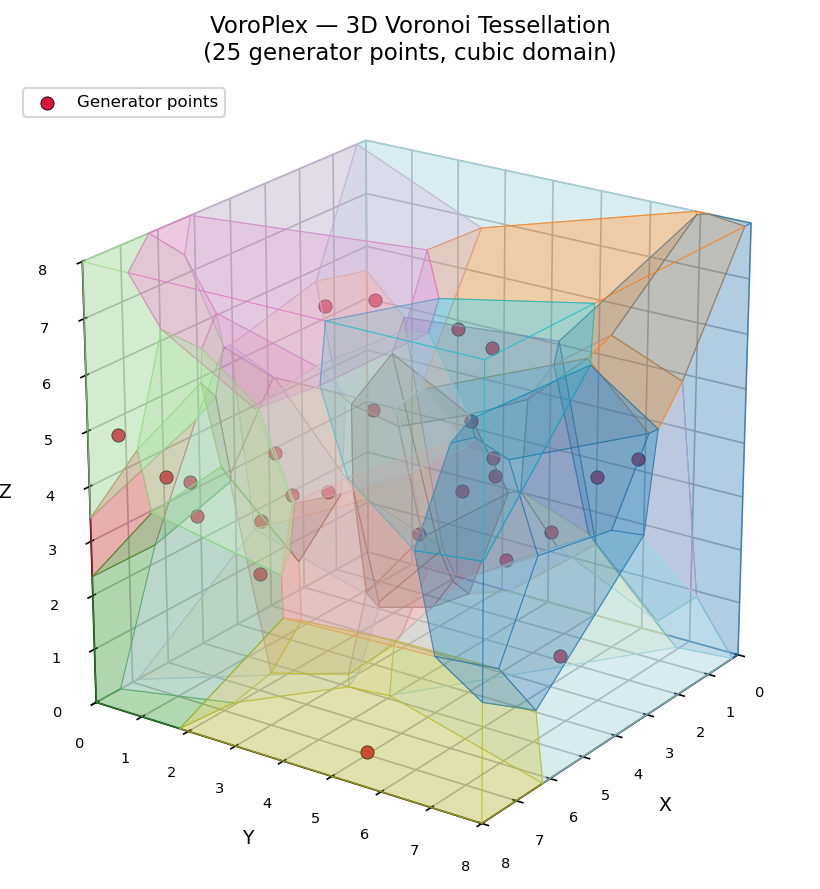
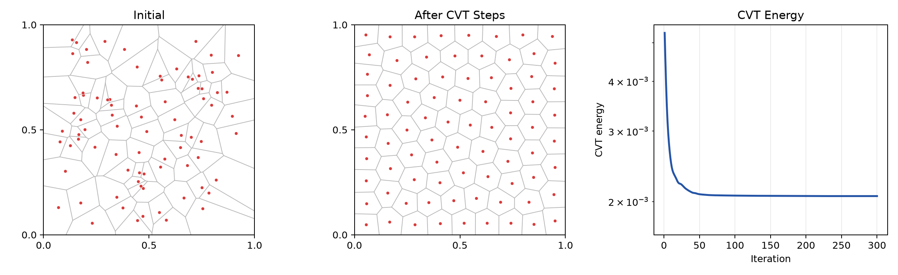

# VoroPlex

VoroPlex is a Python package for computing Voronoi tessellations in two and
three dimensions. It is built on the multi-threaded version of the C++ library
Voro++ [1,2], so that large tessellations can be computed in parallel, and it
returns the result in NumPy arrays. VoroPlex can also make the tessellation
differentiable. It returns the vertices of each cell as a PyTorch tensor, and
computes the derivative of each vertex with respect to the positions of the
generators that define it. Quantities computed from the cells, such as their
areas, volumes, and interface areas, can therefore be optimized with
gradient-based methods [4,5]. The package can also compute radical
tessellations of particles with different sizes, and it includes tools for
extracting the interface between two groups of cells and for exporting
meshes.

By [Jiayin Lu](https://jlu227.wixsite.com/kay-lu)\*, Peihang Lin\*, Mucheng Zhu\*, Shanmei Wanyan\*, Ying Jiang, [Chris H. Rycroft](https://people.math.wisc.edu/~chr/group.html), [Chenfanfu Jiang](https://www.math.ucla.edu/~cffjiang/)

\*Equal contribution

We are very interested to hear from users of the software. If you find it
useful or have any questions, please email Jiayin Lu at
jiayinlu19960224work@gmail.com.

## Table of contents

1. [Overview](#overview)
   - [Directory structure](#directory-structure)
   - [Method](#method)
   - [Related programs](#related-programs)
2. [Installation](#installation)
3. [Basic use](#basic-use)
4. [Compute API](#compute-api)
5. [Result reference](#result-reference)
6. [Inner and outer points](#inner-and-outer-points)
7. [Cell properties](#cell-properties)
8. [Differentiable vertices](#differentiable-vertices)
9. [Radical tessellations](#radical-tessellations)
10. [Mesh utilities](#mesh-utilities)
11. [Analysis utilities](#analysis-utilities)
12. [Export to ParaView](#export-to-paraview)
13. [Serialization](#serialization)
14. [Customization](#customization)
15. [Testing](#testing)
16. [Application examples](#application-examples)
17. [Acknowledgement](#acknowledgement)
18. [Bibliography](#bibliography)

## Overview

The two main functions are `compute_voronoi_2d` and `compute_voronoi_3d`. They compute the cells in parallel, and the `representation` argument
chooses what is stored about them:

- `representation="geometry"` is the default. It returns each cell's
  vertices, faces (edges in 2D), and neighbors, as computed by Voro++.
- `representation="per_cell"` also stores, for every vertex of every cell, the
  signature of the vertex: the IDs of the generators and boundaries of the domain that define
  it. The function `cell_vertices` returns the vertices as a PyTorch tensor
  whose gradient flows back to the generator positions, so that quantities
  computed from the cells can be optimized [4,5].
- `representation="topology"` stores the signatures without the
  coordinates. The vertices, each shared between the cells that meet there,
  are then recomputed in PyTorch from the generator positions, for example
  with `compute_unique_vertices`. This gives differentiable meshes with shared
  vertices.
- `representation=None` stores nothing about the cells themselves, only the
  requested per-cell properties, such as the volume, centroid, or second
  moment of each cell. This uses much less memory and is somewhat faster, for
  example for Lloyd's algorithm, which only needs the centroids.

With every representation, the `properties` argument chooses the quantities
that Voro++ computes for each cell; by default, the volume (3D) or area (2D).
The result is a `VoronoiResult` object, which stores the data for all of the
cells together in a few NumPy arrays, rather than in a separate Python object
for each cell.



VoroPlex adds the following to the multi-threaded Voro++ library:

1. **A Python interface**, with sensible defaults, such as using all of the
   available cores.
2. **A choice of what to store**: the geometry of each cell, differentiable
   vertices, vertices shared between cells, or only some properties of each
   cell, as described above.
3. **Differentiable vertices**: the derivative of each vertex with respect to
   the generators that define it, so that PyTorch can find the gradient of any
   quantity computed from the cells.
4. **Radical tessellations** (`radii`), for particles with different sizes,
   with derivatives with respect to the radii as well as the positions.
5. **Partial computation** (`n_compute`): only the cells of the first
   `n_compute` generators are computed, but all of the generators affect
   their shapes.
6. **Inner and outer generators** (`n_inner`): the faces between inner and
   outer cells can be extracted as a mesh of the interface, for example to
   follow a moving boundary during an optimization.

### Directory structure

`voroplex`: root Python package
> **Core computation**
>
> `voroplex/__init__.py`: the public API — `compute_voronoi_2d`, `compute_voronoi_3d`, `VoronoiResult`, and the functions below
>
> `voroplex/_core/`: validates arguments and wraps the C++ extension
>
> `voroplex/_lib/`: C++ extension module (`voroplusplus_`), and the multi-threaded Voro++ library as a Git submodule (`voro/`)
>
> `voroplex/_result.py`: `VoronoiResult` — the read-only result object with lazy cell and facet views
>
> **Mesh utilities** (require PyTorch)
>
> `voroplex/_mesh/`: differentiable per-cell vertices (`cell_vertices`, `cell_fan_simplices`), and meshes in which the cells share their vertices (`compute_unique_vertices`, `compute_padded_cell_vertices`, `unique_facets`, `cell_polytopes`, `surface_mesh`), each working in 2D and 3D
>
> `voroplex/analysis/`: the geometry of polygon surface meshes in 3D (`compute_surface_geometry`), and of polygon cells in 2D (`compute_polygon_geometry`)
>
> **Export utilities**
>
> `voroplex/export.py`: Voronoi faces as VTU polygons (3D) or line segments (2D) for ParaView (`export_vtu`), and saving and loading a `VoronoiResult` as a versioned NumPy archive (`export_npz`, `load_npz`)
>
> **Tests, documentation, and examples**
>
> `tests/`: the test suite (see [Testing](#testing))
>
> `examples/`: example scripts demonstrating the API

### Method

The tessellation is computed by the multi-threaded Voro++ [2],
which uses OpenMP [3] to compute the cells in parallel. Each
thread stores the cells that it computes in its own buffers, and the result is
then copied, in parallel, into NumPy arrays that are allocated without being
initialized. No Python object is created for each cell.

Each vertex of a cell is defined by the generators whose bisectors meet there
— three generators in 2D, four in 3D — or by fewer generators and one or more
boundaries of the domain. Its *signature* is the sorted list of these generator
IDs, with negative codes for the boundaries. Since the IDs are integers, a vertex
shared by several cells has the same signature in all of them.

The per-cell representation keeps each cell's own copy of its vertices, with
the coordinates computed by Voro++. The vertex `v` satisfies
`2 (p_j - p_1) . (v - p_1) = |p_j - p_1|^2` for each generator `p_j` in its
signature, and `v_axis = boundary` for each boundary of the domain. Differentiating this small
system gives the derivative of the vertex with respect to its generators, and
the backward pass of `cell_vertices` applies it in one parallel loop in C++.
Degenerate vertices, with more constraints than the dimension, use the
least-squares solution. In a periodic domain, each generator is taken to be
its periodic image nearest to the vertex.

The topology representation instead recomputes each vertex, once, by solving
the same system in PyTorch, so that automatic differentiation gives the
gradient. This step also requires PyTorch.

### Related programs

VoroPlex uses the **multi-threaded Voro++** as its underlying tessellation
engine. This builds on the original [Voro++](https://math.lbl.gov/voro++/)
library [1] with the
[multi-threaded extension](https://github.com/chr1shr/voro/tree/dev) [2].

The differentiable vertex reconstruction code in VoroPlex originated from
[**VoroLight**](https://jiayinlu19960224.github.io/vorolight/) [5], a project
for learning Voronoi meshes from general inputs.

## Installation

**Requirements:**

Core (always required):
- Python 3.10+
- NumPy ≥ 1.20
- A C++ compiler with OpenMP support (e.g. `g++` on Linux, or GCC from
  Homebrew or MacPorts on a Mac)

Optional:
- PyTorch ≥ 1.11 — for differentiable vertices (`cell_vertices`,
  `cell_fan_simplices`), the mesh utilities, the surface and cell analysis
  utilities, and `export_vtu`. Works on the CPU; a GPU is not required.
- VTK ≥ 9.0 — for ParaView export (`export_vtu`, in addition to PyTorch)

Voro++ is included as a Git submodule, so clone the repository with
`--recursive`:

```bash
git clone --recursive https://github.com/jiayinlu19960224/pyvoro_multithreaded.git
cd pyvoro_multithreaded
pip install -e .
```

In an existing clone, run `git submodule update --init` to fetch Voro++.
`pip install -e .` compiles the Voro++ sources and the Cython extension into
a single module.

> **Compiler configuration**: the compiler is set in one place —
> `voroplex/_lib/config.mk`. The default is `cc=gcc cxx=g++` (Linux). On a
> Mac, Apple's `clang` does not support OpenMP, so change `cc`/`cxx` to a GCC
> installation from Homebrew before running `pip install -e .`. Use whichever
> version `brew install gcc` provides — `gcc --version` after
> `brew info gcc`, giving for example `cc=gcc-16 cxx=g++-16`.

> **Updating Voro++**: the submodule is pinned to a specific commit of the
> Voro++ `dev` branch. To move to a newer commit, run
> `git submodule update --remote voroplex/_lib/voro`, run the tests, and
> commit the new submodule pointer.

**Optional dependencies**:

```bash
pip install torch   # differentiable vertices, mesh, surface, and cell analysis utilities
pip install vtk     # ParaView VTU export
```

## Basic use

```python
import numpy as np
import voroplex

points = np.random.default_rng(0).random((100_000, 3))
limits = [[0.0, 1.0]] * 3

# Each cell as computed by Voro++ (the default)
geometry = voroplex.compute_voronoi_3d(points, limits, threads="auto")

print(geometry)
print(geometry.volumes.sum())
print(geometry.cell(0).vertices)
print(geometry.cell(0).neighbors)
print([face.vertex_ids for face in geometry.cell(0).faces])

# Differentiable cell vertices (requires PyTorch)
import torch

p = torch.tensor(points, requires_grad=True)
result = voroplex.compute_voronoi_3d(points, limits, representation="per_cell")
vertices = voroplex.cell_vertices(result, p)  # one row per vertex of each cell
```

The 2D entry point, `compute_voronoi_2d`, has the same arguments, with points
of shape `(N, 2)`.

## Compute API

```python
compute_voronoi_3d(
    points,
    limits=None,
    n_compute=None,
    n_inner=None,
    threads="auto",
    periodic=False,
    representation="geometry",
    neighbors=True,
    radii=None,
    properties=None,
)

compute_voronoi_2d(...)   # the same arguments
```

| Parameter | Description |
|---|---|
| `points` | Generator coordinates, shape `(N, 3)` for 3D or `(N, 2)` for 2D. When inner and outer points are used, put all inner points first. No two generators may coincide. |
| `limits` | Domain bounds, shape `(3, 2)` / `(2, 2)`. A 5% margin around the points is used when omitted. The domain is closed: points on its boundary are allowed. |
| `n_compute` | Compute cells with IDs below this value while inserting all points; all points still contribute to tessellation accuracy. Default: all cells. |
| `n_inner` | Points below this value are inner. `surface_cells`/`interface_cells`/`boundary_cells` and interface faces are computed relative to those inner cells. |
| `threads` | OpenMP thread count: a positive int, or `"auto"` for `os.cpu_count()`. |
| `periodic` | Bool or a sequence of 3 (2D: 2) bools, one per axis. |
| `representation` | `"geometry"` (default) — each cell's vertices, faces, and neighbors, as computed by Voro++. `"per_cell"` — the same, plus a signature for every vertex, for differentiation with `cell_vertices`. `"topology"` — signatures without coordinates, for vertices shared between cells and recomputed in PyTorch. `None` — nothing about the cells themselves, only the requested `properties`; see [Cell properties](#cell-properties). |
| `neighbors` | Whether to record the neighbor of each face (default `True`). With `neighbors=False`, Voro++ uses a simpler cell class, which is a few percent faster, but the result has no neighbor IDs or boundary flags. Only with `representation="geometry"`, and not with `n_inner`. |
| `radii` | Generator radii, shape `(N,)`, finite and non-negative. If given, the result is the radical (power) tessellation; see [Radical tessellations](#radical-tessellations). Default: the standard Voronoi tessellation. |
| `properties` | The per-cell quantities to compute, such as `("volume", "centroid")`; see [Cell properties](#cell-properties). Default: the volume (3D) or area (2D) of each cell. `()` computes none. |

Periodic domains work with `"geometry"` and `"per_cell"`. For `"per_cell"`,
the derivative of each vertex uses the periodic image of each defining
generator that is nearest to the vertex; a periodic box that is too small
compared with the cells gives a clear error. The `"topology"` representation
rejects periodic domains.

## Result reference

Common metadata and arrays:

```text
result.dimension
result.representation
result.limits
result.periodic
result.n_points
result.n_cells
result.n_inner
result.threads
result.has_vertices          # geometry and per_cell
result.has_signatures        # per_cell and topology
result.has_cells             # False only with representation=None
result.has_neighbors         # False with neighbors=False or representation=None
result.properties            # the computed cell properties, by name
result.measures              # the areas (2D) or volumes (3D)
result.areas                 # 2D; the other properties are listed below
result.volumes               # 3D
result.surface_cells         # not with neighbors=False
result.interface_cells       # not with neighbors=False
result.boundary_cells        # not with neighbors=False

result.cell_vertex_offsets   int64[n_cells + 1]
result.cell_facet_offsets    int64[n_cells + 1]
result.facet_neighbors       int32[n_facets]          # not with neighbors=False
result.facet_vertex_offsets  int64[n_facets + 1]
result.facet_vertices        int32[n_facet_vertex_refs]
result.cell_surface_flags   uint8[n_cells]           # not with neighbors=False
```

Geometry and per-cell results add the coordinates:

```text
result.vertices              float64[n_local_vertices, dimension]
```

Per-cell and topology results add the signatures:

```text
result.vertex_signature_offsets  int64[n_local_vertices + 1]
result.vertex_signature_ids      int32[n_signature_ids]
```

All arrays are read-only. `facet_vertices` are local vertex IDs within the
owning cell. A vertex shared by several cells occurs once in each of them, as
in Voro++. `facet_neighbors` entries are non-negative neighbor cell IDs, or
negative boundary codes (`-1`/`-2` = xmin/xmax, `-3`/`-4` = ymin/ymax, `-5`/`-6`
= zmin/zmax in 3D; only the first four apply in 2D). Signatures use the same
boundary codes.

Ordinary access does not require manual offset manipulation:

```python
cell = result.cell(5)
cell.id
cell.measure
cell.n_vertices
cell.neighbors
cell.facets

# Geometry and per-cell results
cell.vertices
cell.faces                  # 3D
cell.edges                  # 2D

# Per-cell and topology results
cell.vertex_signatures

facet = cell.facets[0]
facet.neighbor
facet.vertex_ids
```

Cell and facet objects are lazy zero-copy views over the underlying arrays.
`result.cells` is a `Sequence` of all cells, so `len(result.cells)`,
iteration, and slicing all work.

## Inner and outer points

Put inner points first and outer clipping points second. To compute only inner
cells while retaining the influence of all outer points:

```python
n_inner = 80
result = voroplex.compute_voronoi_3d(
    points,
    limits,
    n_compute=n_inner,
    n_inner=n_inner,
)

cells, cell_ids = voroplex.cell_polytopes(result)
print(result.interface_cells)
print(result.boundary_cells)
```

`n_compute=n_inner` inserts all generators but computes cells only for the
inner ones. The facets still contain the neighbor IDs of the outer clipping
points, so complete inner meshes and inner/outer interfaces are available.
`surface_cells` are the cells on the surface of the inner region: those that
touch an outer cell or the boundary of the domain. `interface_cells` and
`boundary_cells` split them into these two cases.

## Cell properties

Voro++ can compute many quantities for each cell. The `properties` argument
chooses which of them to compute, during the parallel loop over the cells.
Each one becomes a read-only array, indexed by generator, and is available as
an attribute of the result and in `result.properties`:

| Property | Attribute | 3D | 2D | Shape and type |
|---|---|---|---|---|
| `"volume"` / `"area"` | `volumes` / `areas` | ✓ | ✓ | `(N,)` float |
| `"surface_area"` / `"perimeter"` | `surface_areas` / `perimeters` | ✓ | ✓ | `(N,)` float |
| `"centroid"` | `centroids` | ✓ | ✓ | `(N, d)` float |
| `"n_faces"` | `n_faces` | ✓ | | `(N,)` int |
| `"n_vertices"` | `n_vertices` | ✓ | ✓ | `(N,)` int |
| `"n_edges"` | `n_edges` | ✓ | | `(N,)` int |
| `"total_edge_length"` | `total_edge_lengths` | ✓ | | `(N,)` float |
| `"max_radius"` | `max_radii` | ✓ | ✓ | `(N,)` float |
| `"second_moment"` | `second_moments` | ✓ | ✓ | `(N,)` float |
| `"second_moment_tensor"` | `second_moment_tensors` | ✓ | ✓ | `(N, d, d)` float |

- The number of faces of a 3D cell is its number of neighbors. In 2D, the
  numbers of vertices, edges, and neighbors are all equal.
- `max_radius` is the largest distance from the generator to a vertex of its
  cell.
- `second_moment` is the integral of `|x - p_i|^2` over the cell, which is
  its energy in a centroidal Voronoi tessellation, and `second_moment_tensor`
  is the integral of `(x - p_i)(x - p_i)^T`.
- The properties are computed by Voro++, relative to each generator, so small
  cells far from the origin keep their precision. They are plain NumPy arrays,
  and are not differentiable; for differentiable quantities, use
  `cell_vertices` and `cell_fan_simplices`.
- For an empty cell in a radical tessellation, the sizes and counts are 0, and
  the centroid and `max_radius` are NaN. In a periodic domain, a centroid can
  lie slightly outside the box.

By default, only the volumes (3D) or areas (2D) are computed, as in the Voro++
command-line program.

When only the properties are needed, `representation=None` stores nothing
else, which saves a great deal of memory and time. For example, an iteration
of Lloyd's algorithm only needs the centroids:

```python
for _ in range(100):
    result = voroplex.compute_voronoi_3d(points, limits, representation=None,
                                      properties=("centroid",))
    points = result.centroids
```

For $10^6$ generators in 3D, the geometry representation stores about 1.2 kB
per cell, and the centroids alone only 24 bytes per cell. On one of our
computers, the whole call was also about 25% faster. A result computed with
`representation=None` cannot be used with the mesh utilities or
`cell_vertices`, and it cannot be used with `n_inner`.

To compute further properties for an existing result, use
`compute_properties`, with the same generator positions:

```python
result = voroplex.compute_voronoi_3d(points, limits)    # only the volumes
props = voroplex.compute_properties(result, points, ["centroid", "second_moment"])
props["centroid"]                                    # shape (N, 3)
```

This computes the tessellation again, with `representation=None`, and the
result's own limits, periodicity, radii, and number of cells, so it is fast,
and gives the same values as requesting the properties in the first place.
It checks that the points match the result, using the stored areas or volumes
if there are any, and otherwise the number of vertices of each stored cell.
A result does not store the points, but `export_npz` can save them with it;
see [Serialization](#serialization).

## Differentiable vertices

With `representation="per_cell"`, each cell keeps its own copy of its
vertices, together with the signature of each vertex. `cell_vertices` returns
these copies as a PyTorch tensor, and its backward pass applies the analytic
derivative of each vertex with respect to its defining generators. Pass the
same point positions that were used to compute the tessellation:

```python
import torch

points_t = torch.tensor(points, dtype=torch.float64, requires_grad=True)
result = voroplex.compute_voronoi_3d(points, limits, representation="per_cell")
vertices = voroplex.cell_vertices(result, points_t)
owners, simplices = voroplex.cell_fan_simplices(result)
loss = vertices.square().sum()
loss.backward()
```

`cell_fan_simplices` splits each cell into triangles (2D) or tetrahedra (3D)
that share the cell's generator as one corner. It returns the cell that owns
each simplex, and the rows of `vertices` at its other corners, which is
convenient for integrals over the cells. Periodic domains are supported.

Notes:

- If the points passed to `cell_vertices` differ from those used to compute
  the tessellation, for example because they were converted to a different
  precision, the backward pass raises an error rather than returning a wrong
  gradient. Use the same precision for both; float64 is recommended.
- Second derivatives (`create_graph=True`) are not supported and raise an
  error.
- On a GPU, the vertex derivative is computed on the CPU, and the data are
  copied between the devices.

With `representation="topology"`, each vertex is instead stored once, shared
between the cells that meet there, and recomputed in PyTorch from the
generator positions by solving the same small linear system:

```python
topology = voroplex.compute_voronoi_3d(points, limits, representation="topology")
vertex_xyz = voroplex.compute_unique_vertices(topology, points_t)
cell_xyz, n_vertices = voroplex.compute_padded_cell_vertices(topology, points_t)
```

Both functions work in 2D and 3D. Degenerate vertices, with more constraints than the dimension, use the
least-squares solution; a singular system, which a genuine Voronoi vertex
never gives, raises an error.

## Radical tessellations

For particles with different sizes, such as a packing of spheres with
several radii, the standard Voronoi tessellation can cut through the larger
particles. The radical tessellation (also called the power diagram or
Laguerre tessellation) takes the radii into account: the cell of generator
`i` is the region where

```
|x - p_i|^2 - r_i^2  <  |x - p_j|^2 - r_j^2    for all j != i.
```

The cells are still convex polygons or polyhedra, with planar faces, so
Voro++ computes them with the same algorithm. With equal radii they are the
Voronoi cells. For two overlapping spheres, the face between their cells is
the plane through the circle where the spheres intersect; for two separate
spheres, it lies in the gap between them [6, 7]. Pass the radii with
`radii=`:

```python
radii = data[:, 3]                 # for example, from an (N, 4) array of x, y, z, r
result = voroplex.compute_voronoi_3d(data[:, :3], limits, radii=radii)
result.is_radical                  # True
result.radii                       # the radii, stored with the result
```

All three representations, periodic domains, `n_inner`, and the mesh and
analysis utilities work as before, with a few differences:

- **Empty cells.** A cell can be empty, for example when a small sphere lies
  inside a larger one. An empty cell has measure 0, and no vertices or
  facets, and it is nobody's neighbor.
- **Generators outside their cells.** A generator can lie outside its own
  cell. The fan simplices from `cell_fan_simplices` are positively
  oriented, so integrals computed from their *signed* areas or volumes are
  still correct: the parts outside the cell cancel. Do not take absolute
  values.
- **Gradients with respect to the radii.** `cell_vertices(result, points_t,
  radii_t)`, `compute_unique_vertices(topology, points_t, radii=radii_t)`, and
  `compute_padded_cell_vertices` (and their 2D versions) accept the radii as a
  tensor, and gradients then flow to it too. Without it, the stored radii
  are used as constants.
- **Coincident generators** still raise an error, even if their radii
  differ.
- **Speed.** Voro++ searches further for neighbors when the largest radius
  is large compared with the spacing between the points, so a wide range of
  radii makes the computation slower.

## Mesh utilities

These functions build meshes in which each vertex is shared between the cells
that meet there. They require PyTorch. Each one works in 2D and 3D, and finds
the dimension from the result. The *facets* of a cell are its edges in 2D, and
its faces in 3D.

```python
facets, facet_info = voroplex.unique_facets(result, facet_type="all")
cells, cell_ids = voroplex.cell_polytopes(result)
surf = voroplex.surface_mesh(result, points)    # points needed for topology
vertices = voroplex.compute_unique_vertices(topology, points_t)
cell_coords, counts = voroplex.compute_padded_cell_vertices(topology, points_t)
```

- `unique_facets(result, facet_type="all")` → `(facets, facet_info)`: each
  facet once, as a list of vertex indices. `facet_type` is `"all"`;
  `"surface"`, for the facets on the surface of the inner region, between an
  inner and an outer cell or on the boundary of the domain; or `"inner"`, for
  the facets between two inner cells. `facet_info[:, 0]` is the owner cell,
  and `facet_info[:, 1]` is the cell on the other side, or a boundary code.
- `cell_polytopes(result)` → `(cells, cell_ids)`: each cell as a polygon (2D),
  given by its vertices in order, or as a polyhedron (3D), given by its faces.
- `surface_mesh(result, points)`: the surface of the inner region as a compact
  mesh, with only the vertices that it uses: `facet_vertex_ids`,
  `vertex_coords`, `n_vertices_per_facet`, `facet_mask`, and
  `facet_neighbors`. In 3D, the vertices of each face are counter-clockwise as
  seen from outside the inner region.
- `compute_unique_vertices(result, points)`: the position of each vertex,
  once, recomputed from the generators; shape `(n_unique_vertices, d)`.
- `compute_padded_cell_vertices(result, points)`: the vertices of each cell,
  padded with zeros to the largest number of vertices, and the number of
  vertices of each cell.

`compute_unique_vertices` and `compute_padded_cell_vertices` recompute the
vertex positions from the signatures, so they require
`representation="topology"`, and their results are differentiable functions of
the generator positions when the points are passed as a tensor. The other
functions also accept the default geometry representation, using the facet
neighbors to match the vertices of neighboring cells, and then give the
coordinates computed by Voro++. They do not support periodic domains, or
results computed with `neighbors=False`.

The vertex numbering of these meshes depends on the representation and the
device, so use the same result and device for the functions whose outputs are
combined.

## Analysis utilities

`voroplex.analysis` provides differentiable geometry for polygon meshes. It
works on any polygon mesh, not only on Voronoi output, and requires PyTorch.
For the surface mesh from `surface_mesh` in 3D:

```python
surf = voroplex.surface_mesh(result, points)

geom = voroplex.analysis.compute_surface_geometry(
    surf["vertex_coords"],
    surf["facet_vertex_ids"],
    surf["n_vertices_per_facet"],
    surf["facet_mask"],
)

print(geom["face_areas"])        # (F,) face areas
print(geom["face_normals"])      # (F, 3) unit normals, out of the inner region
print(geom["adjacency_tensor"])  # (F, max_adj) neighbor face IDs, -1 padded
```

`compute_surface_geometry` splits each face into triangles, and returns a
dictionary of tensors: the basic geometry of each face (area, normal, mean of
the vertices, perimeter, and isoperimetric circularity), the triangles, the
adjacency of the faces and the unique edges, and averages over the neighbors
of each vertex and each face (positions, normals, and areas), which are
useful for smoothing and regularization terms in an optimization. The normals
use Newell's method, and point outward when the vertices of each face are
counter-clockwise as seen from outside, as in the output of `surface_mesh`.

`voroplex.analysis.compute_polygon_geometry` does the same for polygon
*cells* in 2D: given a table of vertex positions (for example from
`compute_unique_vertices`), the vertex indices of each cell (for example from
`cell_polytopes`, padded into a tensor), the number of vertices of each cell,
and a mask for the padding, it returns the area, centroid, perimeter, and edge
lengths of each cell, and the adjacency of the cells.

The results of both functions are differentiable with respect to the vertex
positions.

## Export to ParaView

```python
# 3D
result = voroplex.compute_voronoi_3d(points, limits)
voroplex.export_vtu(result, points, "voronoi.vtu")                          # all faces
voroplex.export_vtu(result, points, "surface.vtu", facet_type="surface")
voroplex.export_vtu(result, points, "inner.vtu",   facet_type="inner")

# 2D
result2 = voroplex.compute_voronoi_2d(points2, limits2)
voroplex.export_vtu(result2, points2, "voronoi_2d.vtu")
```

`export_vtu` works for all three representations, in 2D and 3D; the dimension
is detected automatically. In 3D, faces are exported as polygons; in 2D, edges
are exported as line segments. Like the mesh utilities, it does not support
periodic domains or `neighbors=False`. It requires `pip install vtk` and
`pip install torch`, since PyTorch is used internally to match the shared
vertices.

**3D cell attributes** (polygon faces): `OwnerCell`, `NeighborCell` (negative
= boundary code), `FaceArea`, `OwnerVolume`, and `IsSurface` — only added when
`facet_type="all"`, where it marks the inner/outer interface or the boundary of the domain.

**2D cell attributes** (line edges): `OwnerCell`, `NeighborCell`,
`EdgeLength`, `OwnerArea`, and `IsSurface` — always present; with
`facet_type="all"` it varies per edge, otherwise it is a constant `0`
(`facet_type="inner"`) or `1` (`facet_type="surface"`).

Open the `.vtu` file in ParaView and use Threshold on `IsSurface` to isolate
the boundary surface.

## Serialization

```python
voroplex.export_npz(result, "result.npz")
loaded = voroplex.load_npz("result.npz")
```

The archive is versioned and pickle-free (`allow_pickle=False`). Loading
returns a `VoronoiResult`, not a dictionary. Archives from earlier versions of
VoroPlex can still be read.

A result does not store the generator positions. To save them too, for
example to compute further cell properties later, pass them to `export_npz`:

```python
voroplex.export_npz(result, "result.npz", points=points)
loaded, points = voroplex.load_npz("result.npz", return_points=True)
```

`return_points=True` gives `None` for the points if they were not saved.

## Customization

### Parallel threads

The default is `threads="auto"`, which uses all available CPU cores
(`os.cpu_count()`). Pass an integer to fix the thread count:

```python
result = voroplex.compute_voronoi_3d(points, limits)            # auto threads
result = voroplex.compute_voronoi_3d(points, limits, threads=4) # fixed 4 threads
```

> Best efficiency is reached when the number of threads ≤ the number of
> physical cores.

### Domain limits

`limits` defines the domain boundaries. When omitted, the domain is
auto-computed from the point bounding box with a 5% margin on each side. The
domain must enclose all points, and is closed, so that points exactly on a
boundary are allowed. Pass `limits` explicitly for exact control (e.g. periodic
domains or known boundaries).

```python
limits = [[0, 10], [0, 10], [0, 10]]
result = voroplex.compute_voronoi_3d(points, limits)   # explicit limits
```

### Periodic boundaries

```python
# Periodic in all three axes
result = voroplex.compute_voronoi_3d(points, limits, periodic=True)

# Periodic in x only
result = voroplex.compute_voronoi_3d(points, limits, periodic=[True, False, False])
```

Periodic domains work with `"geometry"` and `"per_cell"`, but not with
`"topology"` (see [Compute API](#compute-api)). In a periodic direction, a
point on the upper boundary is the same as a point on the lower boundary, so two such
points are coincident generators.

## Testing

The tests use pytest. After building the extension in place, run them from
the repository root:

```bash
pip install pytest
python setup.py build_ext --inplace
python -m pytest tests
```

The tests check the tessellation against exact results, the gradients
against closed forms and finite differences, and the agreement between the
representations. Tests that need CUDA or VTK are skipped when these are not
available.

## Application examples

`examples/` contains scripts that cover the whole API, from basic use to the
mesh utilities, surface analysis, and differentiable optimization; see
[`examples/README.md`](examples/README.md) for the full list. The scripts
include:

- **Centroidal Voronoi tessellations (CVTs).** Examples 07 (3D) and 10 (2D)
  move the generators to minimize the energy
  `E = sum_i integral_{cell_i} rho(x) |x - p_i|^2 dV`, by gradient descent.
  With `--density uniform`, the energy is computed exactly, by splitting each
  cell into tetrahedra (3D) or triangles (2D) that share its generator. With
  `--density adaptive`, the density is a Gaussian bump, and the energy is
  found by numerical quadrature on the same pieces.
- **Lloyd's algorithm.** Example 12 computes a CVT with Lloyd's algorithm,
  using `representation=None` to compute only the centroid of each cell.
- **Radical tessellations.** Example 11 compares the Voronoi and radical
  tessellations of a packing of disks with different sizes.
- **The applications in the VoroPlex paper.** Examples 13 and 14 compute CVTs
  with a density that varies in space, in 2D and 3D. Example 15 meshes a 2D
  shape given by a signed distance function, and examples 16 and 17 design
  foams whose cells have a preferred orientation, in 2D and 3D. Their defaults
  and docstrings give the settings used in the paper.



## Acknowledgement

Jiayin Lu was partially supported by the UCLA
[Institute for Digital Research and Education (IDRE)](https://idre.ucla.edu)
Postdoc Fellowship and by an Association for Women in Mathematics (AWM) Mentor
Travel Grant. Chris H. Rycroft was partially supported by the Applied
Mathematics Program of the U.S. DOE Office of Science Advanced Scientific
Computing Research under Contract No. DE-AC02-05CH11231. We also acknowledge
support from the Toyota Research Institute and NVIDIA.

## Bibliography
1. Chris H. Rycroft, *Voro++: A three-dimensional Voronoi cell library in C++*, Chaos **19**, 041111 (2009). [doi:10.1063/1.3215722](https://doi.org/10.1063/1.3215722)

2. Jiayin Lu, Emanuel A. Lazar, and Chris H. Rycroft, *An extension to Voro++ for multithreaded computation of Voronoi cells*, Comput. Phys. Commun. **291**, 108832 (2023). [doi:10.1016/j.cpc.2023.108832](https://doi.org/10.1016/j.cpc.2023.108832)

3. Leonardo Dagum and Ramesh Menon, *OpenMP: An industry standard API for shared-memory programming*, IEEE Comput. Sci. Eng. **5**, 46&#8211;55 (1998). [doi:10.1109/99.660313](https://doi.org/10.1109/99.660313)

4. Logan Numerow, Yue Li, Stelian Coros, and Bernhard Thomaszewski, *Differentiable Voronoi diagrams for simulation of cell-based mechanical systems*, ACM Trans. Graph. **43**, 69 (2024). [doi:10.1145/3658152](https://doi.org/10.1145/3658152)

5. Jiayin Lu, Ying Jiang, Yin Yang, and Chenfanfu Jiang, *VoroLight: Learning quality volumetric Voronoi meshes from general inputs*, [arXiv:2512.12984](https://arxiv.org/abs/2512.12984) (2025).

6. S. C. van der Marck, *Network approach to void percolation in a pack of unequal spheres*, Phys. Rev. Lett. **77**, 1785&#8211;1788 (1996). [doi:10.1103/PhysRevLett.77.1785](https://doi.org/10.1103/PhysRevLett.77.1785)

7. Marielle Pinheiro, Richard L. Martin, Chris H. Rycroft, and Maciej Haranczyk, *High accuracy geometric analysis of crystalline porous materials*, CrystEngComm **15**, 7531&#8211;7538 (2013). [doi:10.1039/c3ce41057a](https://doi.org/10.1039/c3ce41057a)
